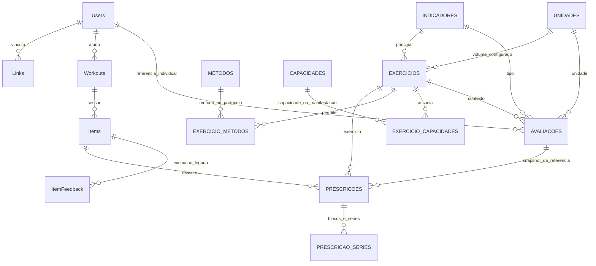

# Biblioteca de exercícios — etapa 1

Base: feature/backend-seguro no commit cd4eb6b, validada por 45 testes antes desta implementação. Desenvolvimento isolado em feature/biblioteca-exercicios. Nenhuma planilha, aplicativo ou demonstração hospedada foi acessada para escrita ou implantada nesta etapa.

## Arquitetura e compatibilidade

O repositório contém HTML/CSS/JavaScript, Google Apps Script V8 e Google Sheets. Backend.gs expõe api(), Auth.gs verifica identidade Google OIDC e emite sessões opacas, Student.gs mantém a prescrição/retorno legado. Requests e ScriptLock implementam reservas de IDs e exclusão mútua. Há demonstrações sem conexão Google e uma suíte Node de testes, já existente. Node continua sendo usado **somente para testes**, não como servidor. Nenhuma dependência ou framework novo foi adicionado.

TrainingLibrary.gs, TrainingLoad.gs e TrainingCatalog.gs são módulos adicionais. libraryApi() usa exatamente sessionIdentity_ e userForEmail_ existentes. Não altera api(), OAuth, telas, contratos antigos ou esquema legado. Também exige ENVIRONMENT=homologation e LIBRARY_SPREADSHEET_ID=SPREADSHEET_ID; não há fallback para outra planilha. Cadastro/configuração do novo domínio exige exatamente um treinador ativo em Users e vínculo ativo com o aluno. Alunos só consultam avaliações/prescrições próprias; a identidade nunca vem de studentId enviado pelo cliente.

O controle multiusuário legado não foi reescrito: a regra de treinador único é aplicada ao módulo novo, e uma configuração com dois treinadores ativos bloqueia sua administração. Usuários ativos e vínculos continuam sendo gerenciados pelos administradores na planilha, conforme a arquitetura atual.

## Entidades lógicas e escolhas físicas

| Entidade solicitada | Representação |
| --- | --- |
| ALUNOS | Users filtrado por role=student, ligado por Links ao treinador. Não criar outro cadastro. |
| SESSOES | Workouts; Items identifica cada item da sessão. Não duplicar sessões. |
| EXERCICIOS | Novo catálogo único, sem classificação geral/direcionado/específico no exercício. |
| CAPACIDADES | Capacidades e manifestações com IDs distintos, tipo explícito e vínculo atual revisável. |
| METODOS | Métodos e protocolos distintos pelo campo kind; subclasse pode apontar parentId. |
| INDICADORES | Definições de intensidade; UNIDADES complementa as grandezas/referências e volumes. |
| AVALIACOES | Registros individuais imutáveis, com valor, unidade, protocolo, definição, datas e supersedesId. |
| PRESCRICOES | Complemento versionado do item existente, com exercício/método/protocolo, intensidade e volume. |
| EXECUCOES | ItemFeedback permanece como registro legado. Estrutura futura por série é especificada abaixo; não há nova API de execução. |

EXERCICIO_CAPACIDADES e EXERCICIO_METODOS são associações N:N justificadas: o exercício não é duplicado ao participar de vários objetivos/métodos. volumeUnitIdsJson permite opções por exercício sem criar uma associação física redundante só para listas pequenas. PRESCRICAO_SERIES representa séries/blocos heterogêneos, evitando pressupor repetições idênticas. volumeJson também conserva o plano de gravação com UUIDs dos filhos para recuperação idempotente após falha parcial; não é outra prescrição lógica.

As relações de protocolo, capacidade e avaliação na prescrição podem ser opcionais conforme o indicador; a referência relativa é obrigatória quando há percentual. O diagrama simplifica cardinalidades: METODOS também fornece methodId/protocolId de PRESCRICOES; unidades fornecem as grandezas dos filhos. IDs não são números de linha. Catálogo inicial usa IDs semânticos estáveis; novos registros e filhos usam UUIDs.

## Intensidade e volume

Cada exercício tem primaryIndicatorId. Cada prescrição informa esse mesmo indicador; auxiliares podem coexistir, sem substituir o principal ou gerar uma intensidade universal.

- Grau: value textual e scale obrigatórios, sem percentuais, interpolação ou conversão entre escalas.
- % da força máxima, %1RM, %FCmáx, % amplitude: referência individual do mesmo aluno/exercício/indicador, tipo/unidade compatíveis, protocolo e definição explícitos. O alvo é valor da referência × percentual/100, conservando unidade, protocolo e contexto. Não se presume equivalência entre referências ou protocolos.
- Campus board: somente descrição qualitativa, marcada methodologyPending. Campos percent/value numéricos são rejeitados. Nenhuma fórmula mecânica foi inventada.
- RPE auxiliar: valor 1–10 separado; não calcula carga interna.

Os limites numéricos do software são barreiras técnicas contra dados inválidos/overflow, **não recomendações fisiológicas** (percentuais positivos até 1000, máximo de 100 linhas de volume, total até 1e12). Não aplicar os exemplos automaticamente aos alunos.

Volume é sempre acompanhado de mode e unitId. Isometria soma suspensões × segundos em cada série; repetições soma cada série; escalada soma movimentos de mão em cada boulder/bloco; corrida/alongamento podem usar tempo ou as outras unidades configuradas. Não há soma universal, conversão automática de unidades ou cálculo global de carga. Para movimentos de mão, o total informado inclui progressões, junções e reboteios; não há campos separados para essas categorias.

libraryVolume_ também valida mode=executed para a futura integração, admitindo quantidades zero/heterogêneas. A API nova **só grava prescribed**. Não calcula volume realizado a partir do prescrito nem trata o feedback legado agregado como medição completa por série.

## Integridade, histórico e limites

Exercícios duplicados são rejeitados pelo nome normalizado (acentos, caixa e espaços), inclusive se a primeira gravação deixou apenas uma reserva Requests. Isso não detecta sinônimos técnicos diferentes: o treinador deve revisar semanticamente o catálogo. Métodos/capacidades são vinculados sem duplicar o exercício.

Avaliações não são atualizadas: uma nova avaliação pode apontar supersedesId da anterior. Uma avaliação substituída, inativa, posterior à data da sessão ou cujo validUntil precede a sessão é rejeitada para **nova prescrição**. Não há prazo de validade fisiológico presumido: o treinador informa validUntil. Protocolos diferentes podem exigir avaliações distintas; referenceDefinition deve explicar por exemplo agarra, apoio, articulação, carga total/adicional e critério do teste. O servidor não interpreta esse texto como fórmula.

Prescrições guardam snapshot do catálogo, método, protocolo, classificação e referências usadas, além de parâmetros e linhas de volume. Correções criam revisão com supersedesId e expectedRevision; não modificam a anterior. Consultar uma prescrição histórica não revalida sua avaliação contra a data atual: seu snapshot permanece disponível. Não inferir revisão corrente apenas por status=active; usar a maior revision por item. Para uma nova avaliação, a anterior permanece fisicamente intacta, mas fica inelegível por ter sucessora.

Escritas são serializadas pelo mesmo ScriptLock. Requests é reutilizado; mesma chave/conteúdo devolve o registro e repara filhos pendentes, conteúdo diferente retorna CONFLICT. Reservations de nome e revisão impedem duplicações mesmo após falha parcial. O conteúdo JSON é limitado a 45000 caracteres para respeitar células Sheets. Inicialização verifica todos os cabeçalhos existentes antes da primeira alteração, só cria abas/cabeçalhos ausentes, não altera registros de mesmo ID e retoma carga parcial. Não limpa linhas, não renomeia abas e não inicializa o esquema legado implicitamente.

Sheets não oferece transações ACID. Uma falha pode deixar reserva ou prescrição com filhos ainda pendentes; repetir exatamente a requisição original completa a gravação. Não tratar os dados como aprovados no Google antes de homologar falhas/repetições reais. As restrições são de aplicação: editores diretos de Sheets podem contorná-las. Histórico não é protegido contra edição manual de um administrador; não editar esses registros diretamente. Leituras completas e verificações repetidas de configuração limitam escala; esta etapa não promete capacidade de produção.

## Estrutura futura de execução

ItemFeedback já guarda workoutId/itemId/studentId, estado, valores agregados e revisão. Não duplicar ou reinterpretar esses registros. Uma futura tabela filha EXECUCAO_SERIES deverá conter id (UUID), executionId→ItemFeedback, prescriptionId→PRESCRICOES, blockOrder, setOrder, quantity, occurrences, durationSeconds, volumeUnitId, total e recordedAt. A referência explícita à revisão prescrita é essencial: não inferi-la pela revisão atual do item.

Essa tabela e sua API **não são criadas nesta etapa**: estão especificadas para futura autorização de registro por série. Nenhum volume executado real foi importado ou migrado. Novas prescrições ainda não alimentam automaticamente ItemPrescription nem as telas atuais; essa ponte precisa ser definida sem perder parâmetros multidimensionais.

## Decisões pendentes para revisão

1. Definição do indicador mecânico do campus board.
2. Protocolos formais de força máxima em fingerboard; distinção de força, massa/carga total, assistência e carga adicional. Não converter N, kgf e kg automaticamente.
3. Validação metodológica do exemplo inicial de %1RM no fingerboard dinâmico e dos protocolos de barra fixa. O exemplo exige avaliação explícita, mas não constitui validação do teste.
4. Escalas de graduação aceitas e eventual comparabilidade: nenhuma conversão implementada.
5. Política de validade das avaliações e revisão das manifestações, mantendo IDs históricos. Os nomes/associações iniciais são revisáveis, não uma taxonomia fisiológica definitiva.
6. Edição/ativação/inativação de catálogos por API versionada. Nesta etapa há cadastro/consulta e status de cadastro; não há endpoint de edição/desativação. Inicialização não reativa registros existentes.
7. Ponte entre prescrição nova, telas legadas e futura execução por série/bloco; política de correções e janela de registro.

Não foram implementados novos painéis, periodização, carga interna, dashboards, migração ou implantação. Ver DICIONARIO.md e VALIDACAO.md para os demais entregáveis.
